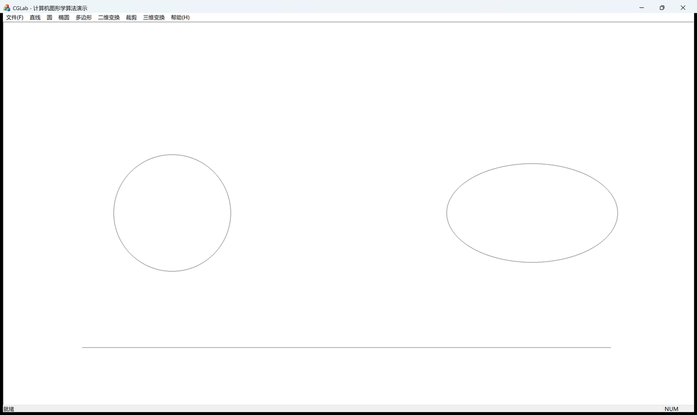
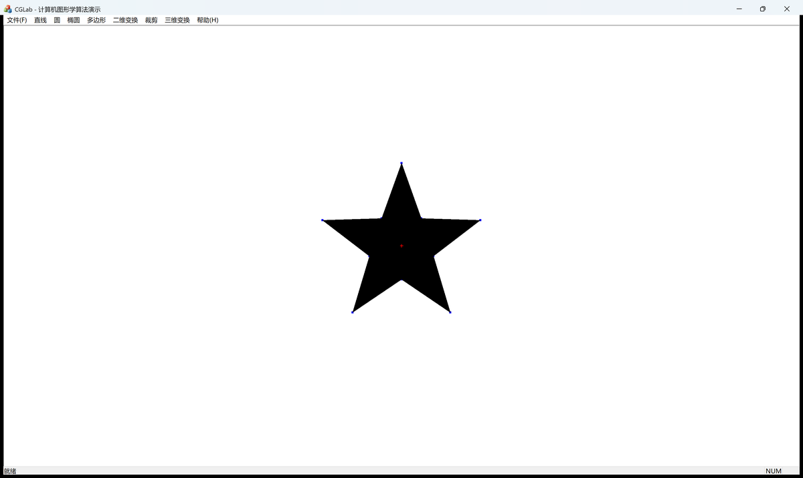
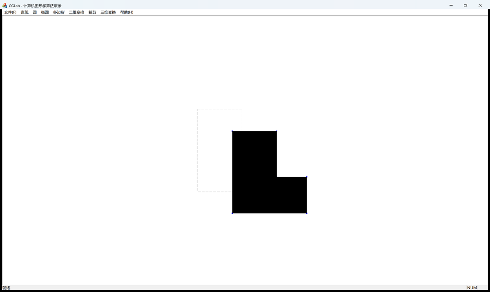
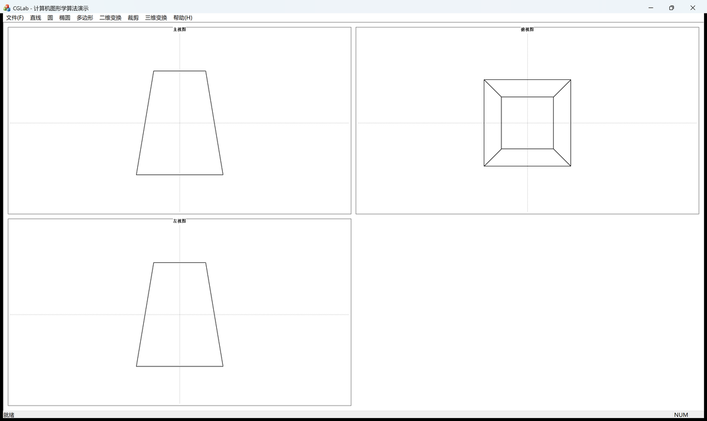

# CGLab 计算机图形学算法演示程序

基于 **MFC + C++17** 的计算机图形学经典算法可视化程序，包含直线、圆、椭圆生成，多边形填充，二维/三维几何变换，直线与多边形裁剪，以及三视图等内容。界面已中文化，并为参数输入和几何变换提供了灰色实时预览。

- 当前仓库：<https://github.com/chenwenda316/CGLab>
- 原项目：<https://github.com/sophiel-meow/CGLab>
- 适用课程：山东农业大学计算机图形学

## 界面截图

<table>
<tr>
<td></td>
<td></td>
</tr>
<tr>
<td></td>
<td></td>
</tr>
</table>

## 功能特性

### 1. 直线生成
- DDA 算法
- 中点画线算法
- Bresenham 算法

### 2. 圆与椭圆生成
- 圆：中点算法、Bresenham 圆算法
- 椭圆：Bresenham 椭圆算法

### 3. 多边形填充
- X-扫描线填充
- 四邻域种子填充
- 八邻域种子填充

### 4. 二维几何变换
- 平移、旋转、错切、缩放、对称
- 变换对象为画布上的**全部图形**（直线、圆、椭圆、多边形）
- 种子点随图形一起变换，填充结果保持正确

### 5. 裁剪
- Cohen-Sutherland 直线裁剪
- 多边形裁剪（矩形窗口，Sutherland-Hodgman 实现）

### 6. 三维图形
- 斜二侧投影显示四棱台
- 三维平移、旋转、缩放、错切、对称
- 主视图、俯视图、左视图三视图显示，支持与斜二侧投影来回切换

### 7. 灰色预览
- **二维/三维变换**：用灰色虚线保留变换前的图形，便于对比
- **直线/圆/椭圆**：在参数对话框中输入时，画布实时显示灰色预览，确定后变黑色正式图形
- **种子填充**：多边形闭合后，鼠标在多边形内部移动时显示灰色填充区域，点击后才正式填充
- 预览只在需要的地方出现，取消或确定后自动清除

## 使用方法

1. 通过菜单选择算法：`直线`、`圆`、`椭圆`、`多边形`、`二维变换`、`裁剪`、`三维变换`。
2. 直线/圆/椭圆：在对话框中输入参数，画布上会实时显示灰色预览，点击“确定”生成黑色图形。
3. 多边形：
   - 左键依次添加顶点，右键闭合并结束绘制；
   - 种子填充模式下，闭合后移动鼠标可看到灰色填充预览，左键选择种子点完成填充。
4. 二维变换：先绘制图形，再选择平移/旋转/错切/缩放/对称；灰色虚线为变换前轮廓。
5. 裁剪：设置裁剪窗口后输入直线，或使用多边形裁剪；裁剪窗口和多边形结果会同时显示。
6. 三维：先选择 `三维变换 -> 原始图形（斜二侧）`，再进行各类变换；`三视图/斜二侧（切换）` 可在两种显示方式间切换。
7. `文件 -> 清除` 清空画布。

## 技术实现

- 面向对象设计，图形统一继承 `GraphicsObject`
- Strategy 模式切换算法（`ILineAlgorithm`、`ICircleAlgorithm`、`IEllipseAlgorithm`、`IPolygonAlgorithm` 等）
- 使用现代 C++：`std::shared_ptr`、`std::unique_ptr`、`std::vector`、lambda 等
- 双缓冲绘制，减少闪烁
- MFC 单文档界面（SDI），菜单和对话框操作

### 关键类

| 类 | 说明 |
| --- | --- |
| `GraphicsObject` | 所有二维图形的基类，定义绘制、生成点和轮廓接口 |
| `Line` / `Circle` / `Ellipse` / `Polygon` | 具体图形对象 |
| `Point2D` / `Point3D` | 二维/三维点 |
| `Matrix3x3` / `Matrix4x4` | 齐次坐标变换矩阵 |
| `Transform2D` / `Transform3D` | 平移、旋转、错切、缩放、对称矩阵 |
| `*Algorithms` | 具体算法实现 |
| `CCGLabView` | 视图、交互、预览和绘制调度 |
| `Frustum` / `Object3D` | 三维四棱台和三视图投影 |

## 目录结构

```
CGLab/
├── CGLab.sln
├── CGLab/
│   ├── CGLab.cpp / CGLab.h          # 应用程序
│   ├── MainFrm.cpp / MainFrm.h      # 主框架窗口
│   ├── CGLabDoc.cpp / CGLabDoc.h    # 文档
│   ├── CGLabView.cpp / CGLabView.h  # 视图与交互
│   ├── Line / Circle / Ellipse / Polygon ...     # 图形对象
│   ├── *Algorithms.cpp / .hpp                    # 各类算法
│   ├── Transform2D / Transform3D                 # 二维/三维变换
│   ├── Matrix3x3 / Matrix4x4 / Point2D / Point3D # 数学基础
│   ├── Frustum / Object3D                        # 三维模型与投影
│   ├── *InputDlg / TransformDlg / ClipWindowDlg  # 参数对话框
│   └── CGLab.rc / resource.h                     # 菜单、对话框、字符串资源
└── screenshoots/                                 # README 截图
```

## 开发环境

- Visual Studio 2022（v143 工具集）
- Windows SDK 10.0
- C++17
- MFC：在静态库中使用 MFC（同时使用静态 CRT）
- 字符集：Unicode

## 构建与运行

1. 使用 Visual Studio 2022 打开 `CGLab.sln`。
2. 配置选择 **Release | x64**（或 Debug | x64）。
3. 生成解决方案。
4. 可执行文件位于：

   ```
   x64\Release\CGLab.exe
   ```

   由于使用静态 MFC 和静态 CRT，该 exe 只依赖 Windows 系统 DLL，可直接复制到其他 64 位 Windows 上运行，无需安装 VC++ 运行库。

## 主要修复记录

- 修复椭圆 Bresenham 判别式中 `int` 中间结果溢出导致椭圆被截断的问题（改为 `double` 运算）
- 修复 Bresenham 画线在反向（dx/dy 为负）时斜率错误的问题
- 修复中点画线在陡峭且斜率为负时无法生成点的问题
- 修复 DDA 起终点重合时除零的问题
- 修复 `Line::SetAlgorithm` 缺少 `break` 导致 Bresenham 实际使用 DDA 的问题
- 二维变换改为作用于所有图形，并同步变换种子点
- 多边形裁剪由不可用的递归二分实现改为正确的 Sutherland-Hodgman
- 增加直线/圆/椭圆/种子填充的灰色预览
- 菜单、对话框、关于框中文化

## 许可与致谢

本项目遵循 **MIT License**，原始版权声明保留在 [LICENSE.txt](LICENSE.txt) 中：

- 原始设计/实现：**Ziyu ZHOU @ SDAU**（2024）
- 许可证版权：**Copyright (c) 2024 Jun Amane**
- 界面中文化、算法修复与功能增强：**陈文达**（2026）

修改版本仓库：<https://github.com/chenwenda316/CGLab>

---

*Designed by Ziyu ZHOU at SDAU, 30th Nov. 2024. Maintained and extended by Chen Wenda, 2026.*
